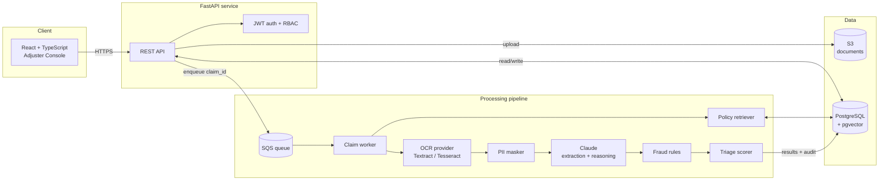

# ClaimLens

**AI-assisted insurance claim triage.** ClaimLens reads claim documents (forms, invoices, photos, police reports), extracts the key facts, checks them against the policy wording, flags fraud signals, and routes each claim to the right queue so adjusters spend their time on the claims that actually need a human.

> Status: architecture and project skeleton. Source-only project, runs locally with Docker Compose. Not deployed.

---

## The problem

A typical property and auto insurer receives thousands of claims a week. Each one arrives as a pile of unstructured documents. Adjusters spend a large part of their day just *reading*: pulling out dates, amounts, policy numbers and descriptions, then looking up whether the policy covers the loss. Simple claims wait in the same queue as complex or suspicious ones.

ClaimLens automates the reading and the first-pass assessment, and leaves the decision with the adjuster.

## What it does

| Step | What happens |
| --- | --- |
| **Intake** | Claimant or agent uploads documents; files go to object storage and a job is queued |
| **OCR** | Text is extracted from PDFs, scans and photos (AWS Textract, or Tesseract locally) |
| **PII masking** | SSNs, bank and card numbers are masked before anything reaches the LLM |
| **Extraction** | Claude turns the text into a structured claim (who, what, when, where, how much) using tool-based structured output |
| **Coverage check (RAG)** | Relevant policy clauses are retrieved from pgvector and Claude explains whether the loss appears covered, citing clause IDs |
| **Fraud signals** | Rule-based checks (duplicate invoices, date mismatches, amount outliers) plus LLM-flagged inconsistencies |
| **Triage** | A severity and risk score routes the claim to **Fast-track**, **Standard review** or **Investigate** |
| **Review** | Adjusters see the summary, citations and flags, then approve, request info or escalate. Every action is audit-logged |

## Architecture



More diagrams (sequence, class, ER, state, deployment) are in [`docs/`](docs/).

## Tech stack

| Layer | Technology |
| --- | --- |
| API | Python 3.12, FastAPI, Pydantic v2, SQLAlchemy 2, Alembic |
| Worker | Python, boto3 (SQS/S3/Textract), Anthropic SDK |
| AI | Anthropic Claude (structured extraction, coverage reasoning), embeddings via Amazon Bedrock Titan or a local sentence-transformers model |
| Data | PostgreSQL 16 + pgvector (HNSW index), S3 (LocalStack locally) |
| Frontend | React 18, TypeScript, Vite, TanStack Query |
| Local cloud | LocalStack (S3, SQS) |
| Quality | pytest, Ruff, mypy, GitHub Actions CI |
| Infra as code | Terraform module for AWS (ECS Fargate, SQS, S3, RDS). Written, **not applied** |

## Quick start

```bash
cp .env.example .env          # add your ANTHROPIC_API_KEY
docker compose up --build     # postgres, localstack, api, worker, web
```

- Adjuster console: http://localhost:5173
- API docs (Swagger): http://localhost:8000/docs

## Project structure

```
claimlens/
├── backend/
│   ├── app/
│   │   ├── main.py               # FastAPI app factory
│   │   ├── api/routes/           # claims, documents, policies, health
│   │   ├── core/                 # config, security, logging
│   │   ├── db/                   # SQLAlchemy models, session
│   │   ├── schemas/              # Pydantic request/response models
│   │   ├── services/             # ocr, pii, extraction, retrieval, fraud, triage
│   │   └── workers/              # SQS consumer
│   ├── tests/
│   ├── pyproject.toml
│   └── Dockerfile
├── frontend/                     # React + Vite adjuster console
├── infra/terraform/              # AWS module (not applied)
├── docs/
│   ├── architecture.md
│   ├── diagrams/                 # sequence, class, ER, state, deployment
│   └── adr/                      # architecture decision records
├── docker-compose.yml
├── .env.example
└── .github/workflows/ci.yml
```

## Skills demonstrated

Python · FastAPI · Generative AI · Anthropic Claude · RAG · pgvector / HNSW · prompt engineering · AWS (S3, SQS, Textract, Bedrock, ECS Fargate) · Terraform · Docker · PostgreSQL · React · TypeScript · event-driven architecture · PII protection · CI/CD

## Roadmap

- [x] Architecture, diagrams and project skeleton
- [ ] Document upload and SQS pipeline
- [ ] OCR + PII masking
- [ ] Claude structured extraction
- [ ] Policy ingestion and RAG coverage check
- [ ] Fraud rules and triage scoring
- [ ] Adjuster console
- [ ] LLM evaluation suite (golden claims with expected outputs)

## License

MIT
