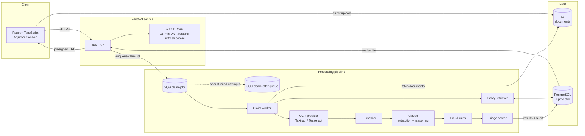

# ClaimLens

**AI-assisted insurance claim triage.** ClaimLens reads claim documents (forms, invoices, photos, police reports), extracts the key facts, checks them against the policy wording, flags fraud signals, and routes each claim to the right queue so adjusters spend their time on the claims that actually need a human.

> Status: feature-complete source project with integration tests. Runs locally with Docker Compose; not deployed.

---

## The problem

A typical property and auto insurer receives thousands of claims a week. Each one arrives as a pile of unstructured documents. Adjusters spend a large part of their day just *reading*: pulling out dates, amounts, policy numbers and descriptions, then looking up whether the policy covers the loss. Simple claims wait in the same queue as complex or suspicious ones.

ClaimLens automates the reading and the first-pass assessment, and leaves the decision with the adjuster.

## What it does

| Step | What happens |
| --- | --- |
| **Intake** | Claimant or agent uploads documents; files go to object storage and a job is queued |
| **OCR** | Text is extracted from PDFs, scans and photos (AWS Textract, or Tesseract locally) |
| **PII masking** | SSNs, bank and card numbers are masked before anything reaches the LLM |
| **Extraction** | Claude turns the text into a structured claim (what, when, where, how much, severity, contradictions) using JSON-schema structured outputs |
| **Coverage check (RAG)** | Relevant policy clauses are retrieved from pgvector and Claude explains whether the loss appears covered, citing clause IDs |
| **Fraud signals** | Rule-based checks (duplicate invoices, date mismatches, amount outliers) plus LLM-flagged inconsistencies |
| **Triage** | A severity and risk score routes the claim to **Fast-track**, **Standard review** or **Investigate** |
| **Review** | Adjusters see the summary, citations and flags, then approve, request info or escalate. Every action is audit-logged |

## Architecture



The full design, including reliability, idempotency, security and scaling, is in [`docs/architecture.md`](docs/architecture.md). More diagrams (sequence, class, ER, state, deployment) are in [`docs/diagrams/`](docs/diagrams/).

## Tech stack

| Layer | Technology |
| --- | --- |
| API | Python 3.12, FastAPI, Pydantic v2, SQLAlchemy 2, Alembic |
| Worker | Python, boto3 (SQS/S3/Textract), Anthropic SDK |
| Auth | 15-minute JWT access tokens, rotating single-use refresh tokens in an httpOnly cookie (hashed at rest, reuse detection), PBKDF2 password hashing, role-based access (adjuster, supervisor, admin) |
| AI | Claude Opus 5.5 via the Anthropic SDK: structured outputs, prompt caching on the system prompts, server-side refusal fallback. Embeddings: Amazon Bedrock Titan v2, a local sentence-transformers model, or a dependency-free hashing embedder for development |
| Data | PostgreSQL 16 + pgvector (HNSW index), S3 (LocalStack locally) |
| Frontend | React 18, TypeScript, Vite, TanStack Query |
| Local cloud | LocalStack (S3, SQS) |
| Quality | pytest, Ruff, mypy, GitHub Actions CI |
| Infra as code | Terraform module for AWS (ECS Fargate, SQS, S3, RDS). Written, **not applied** |

## Quick start

```bash
cp .env.example .env          # add ANTHROPIC_API_KEY and a random JWT_SECRET
docker compose up --build     # postgres, localstack, api, worker, web
```

- Adjuster console: http://localhost:5173
- API docs (Swagger): http://localhost:8000/docs

Seed users for local development (change them with `SEED_USERS`):

| Role | Email | Password |
| --- | --- | --- |
| Adjuster | adjuster@claimlens.dev | adjuster123 |
| Supervisor | supervisor@claimlens.dev | supervisor123 |
| Admin | admin@claimlens.dev | admin123 |

Index policy wording first (admin): `POST /api/v1/policies`, upload the file to the returned URL, then `POST /api/v1/policies/{id}/index`.

## Tests

```bash
docker run -d -p 55432:5432 -e POSTGRES_USER=claimlens -e POSTGRES_PASSWORD=claimlens -e POSTGRES_DB=claimlens_test pgvector/pgvector:pg16
docker run -d -p 54566:4566 -e SERVICES=s3,sqs localstack/localstack:3.8
cd backend && pip install -e ".[dev]"
LOCALSTACK_URL=http://localhost:54566 pytest
```

30 tests cover the full flow (API, worker, pipeline, pgvector retrieval), PII never reaching the model, invalid-citation retry, duplicate-document fraud detection, idempotent reprocessing, role rules, team isolation, and the S3/SQS adapters against LocalStack. Claude is replaced by a fake in tests, so they are free and deterministic.

## Evaluating the prompts

`backend/evals/` holds golden claims (covered loss, excluded flood, wear and tear, conflicting dates, prompt injection) and a runner that calls the real Claude API:

```bash
cd backend && ANTHROPIC_API_KEY=... python -m evals.run_evals
```

This costs API credits and is not run in CI.

## Project structure

```
claimlens/
├── backend/
│   ├── app/
│   │   ├── main.py               # FastAPI app factory
│   │   ├── api/routes/           # claims, documents, policies, health
│   │   ├── core/                 # config, security, logging
│   │   ├── db/                   # SQLAlchemy models, session
│   │   ├── schemas/              # Pydantic request/response models
│   │   ├── services/             # ocr, pii, llm, extraction, chunking, embeddings,
│   │   │                         # retrieval, coverage, fraud, triage, pipeline
│   │   └── workers/              # SQS consumer
│   ├── tests/
│   ├── pyproject.toml
│   └── Dockerfile
├── frontend/                     # React + Vite adjuster console
├── infra/terraform/              # AWS module (not applied)
├── docs/
│   ├── architecture.md
│   ├── diagrams/                 # sequence, class, ER, state, deployment
│   └── adr/                      # architecture decision records
├── docker-compose.yml
├── .env.example
└── .github/workflows/ci.yml
```

## Skills demonstrated

Python · FastAPI · Generative AI · Anthropic Claude · RAG · pgvector / HNSW · prompt engineering · AWS (S3, SQS, Textract, Bedrock, ECS Fargate) · Terraform · Docker · PostgreSQL · React · TypeScript · event-driven architecture · PII protection · CI/CD

## Status

- [x] Architecture, diagrams and design decisions
- [x] Document upload with presigned S3 URLs and the SQS pipeline (retries + dead-letter queue)
- [x] OCR (Tesseract or Textract) and PII masking
- [x] Claude structured extraction
- [x] Policy ingestion and pgvector RAG coverage check with validated citations
- [x] Fraud rules and triage scoring
- [x] Auth with 15-minute access tokens and rotating refresh tokens (hashed, reuse detection)
- [x] Adjuster console with role-based decisions and a full audit trail
- [x] LLM evaluation set
- [ ] Apply the Terraform module to a real AWS account
- [ ] Human feedback loop: adjuster overrides become new eval cases

## License

MIT
