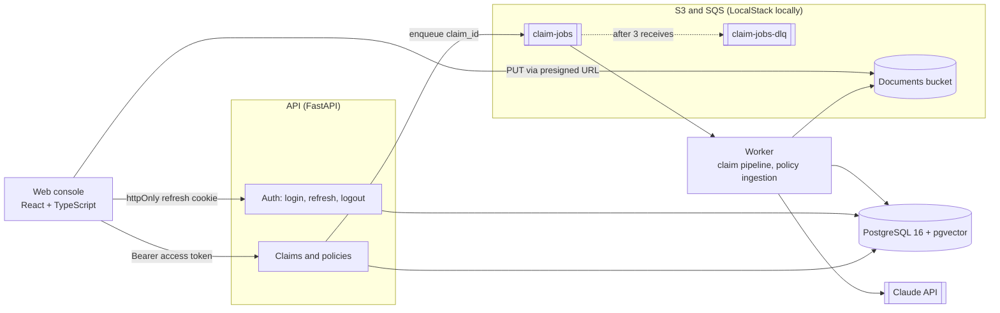
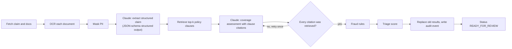
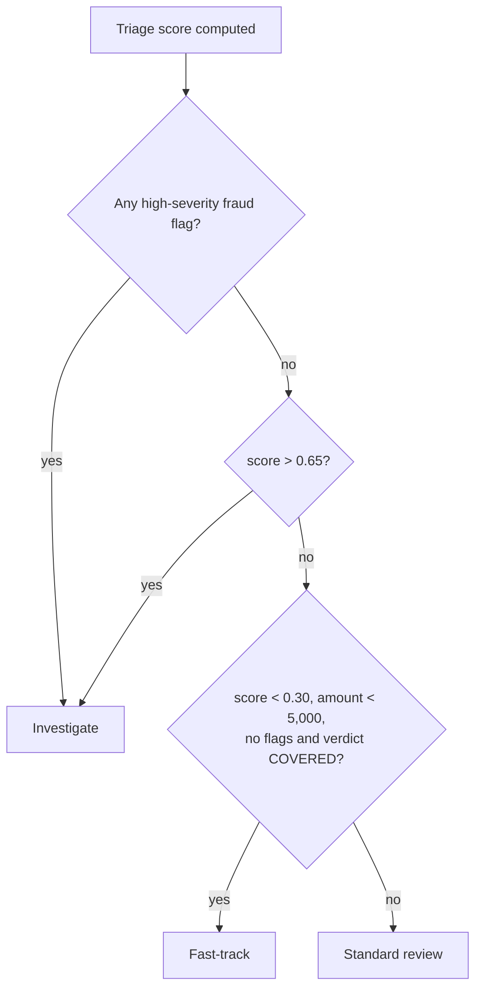
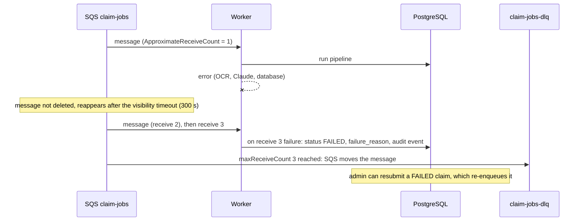

# ClaimLens architecture

## 1. Goals and constraints

| Goal | How the design addresses it |
| --- | --- |
| Adjusters stay in control | The system only *recommends* a queue and a summary. Every decision is a human action, and every action is audit-logged |
| No sensitive data sent to the LLM | PII is masked after OCR and before any model call; the token map exists only in worker memory for that run and is never stored or put in a prompt |
| Explainable output | Coverage reasoning must cite policy clause IDs that retrieval actually returned; an answer citing anything else is rejected and retried once |
| Uploads never block | Upload returns immediately; processing runs asynchronously from a queue, with retries and a dead-letter queue |
| Safe to retry | Every pipeline run replaces the previous attempt's results, so a redelivered message never duplicates data |
| Runs on a laptop | Every AWS dependency has a local stand-in (LocalStack, Tesseract, local embeddings) behind an interface |

## 2. System context

## 3. Containers

| Container | Responsibility | Tech |
| --- | --- | --- |
| **Web** | Adjuster console: queues, claim detail, evidence viewer, actions. Keeps the access token in memory and refreshes it on 401 or page reload | React, TypeScript, Vite |
| **API** | Auth (login, refresh-token rotation, logout), claim and document endpoints, presigned uploads, review actions | FastAPI |
| **Worker** | Consumes `claim.submitted` and `policy.uploaded` jobs and runs the pipeline | Python, boto3 |
| **PostgreSQL + pgvector** | Users, refresh-token hashes, claims, extracted fields, policy chunks and embeddings, audit log | Postgres 16 |
| **Object storage** | Raw documents and policy files | S3 (LocalStack locally) |
| **Queue** | Decouples upload from processing; moves a message to the dead-letter queue after 3 failed receives | SQS (LocalStack locally) |

## 4. Worker pipeline

Each stage is a service class behind a small interface (a Python `Protocol`), so providers can be swapped (Textract or Tesseract, Bedrock, local or hash embeddings) without touching the pipeline.

Claude calls use `claude-opus-5-5` with structured outputs, so responses always match the schema. The fixed system prompts are prompt-cached, and a server-side fallback model answers if the primary model declines. A refusal that still comes back marks the claim `FAILED` straight away instead of retrying.

**Fraud rules:** `DUPLICATE_DOCUMENT` (same SHA-256 seen on another claim), `LOSS_AFTER_SUBMISSION`, `DOCUMENT_PREDATES_LOSS`, `AMOUNT_OVER_LIMIT`, `ROUND_AMOUNT`, `LOW_OCR_CONFIDENCE` and `DOCUMENT_INCONSISTENCY` (inconsistencies Claude reported during extraction).

## 5. Triage scoring

`score = 0.45 × severity + 0.35 × fraud_risk + 0.20 × coverage_uncertainty` (each between 0 and 1)

Weights and thresholds live in configuration, not code. A claim whose coverage is `UNCLEAR` (for example, no policy indexed for the product) can never be fast-tracked.

## 6. Reliability and idempotency

| Concern | Mechanism |
| --- | --- |
| Duplicate delivery | SQS is at-least-once. Each run deletes and rewrites the claim's facts, coverage and flags, and overwrites masked OCR text, so a second run leaves the same end state |
| Double submit | `POST /claims/{id}/submit` only accepts `DRAFT`, `AWAITING_INFO` or `FAILED` claims; a second call gets `409` |
| Transient failures | Message reappears after the visibility timeout; up to 3 attempts |
| Permanent failures | Claim marked `FAILED` with the reason; the message lands in `claim-jobs-dlq` for inspection; admin-only requeue |
| Model refusal | Not retried; goes straight to `FAILED` for a human |
| Invalid model output | Structured outputs guarantee the schema; invalid clause citations are retried once, then the claim fails |

## 7. Security

- **Authentication:** short-lived JWT access tokens (HS256, 15 min, kept in memory by the console) and single-use refresh tokens (14 days) in an httpOnly, SameSite=Strict cookie scoped to `/api/v1/auth`. Only a SHA-256 hash of each refresh token is stored. Every refresh rotates the token, and replaying a used one revokes every session for that user ([sequence](diagrams/sequence-auth-refresh.md)). Passwords are hashed with PBKDF2-SHA256 (310,000 iterations)
- **Authorization:** roles `ADJUSTER`, `SUPERVISOR`, `ADMIN`; users only see their own team's claims; denials and approvals with a HIGH fraud flag need a supervisor; only an admin can requeue a failed claim
- **PII:** regex and checksum detectors (SSN, card numbers with Luhn check, IBAN, phone, email); tokens like `[SSN_1]` replace values before text is stored or sent to Claude
- **Prompt injection:** document text is passed as data inside clearly delimited blocks; responses are constrained to a JSON schema and the model has no tools, so it cannot trigger actions
- **Audit:** append-only `audit_events` table records every status change, pipeline result (queue, score, verdict, flags, model) and human decision. Per-call token usage and latency go to the worker log

## 8. Scaling

| Part | How it scales | Limit to watch |
| --- | --- | --- |
| API | Stateless (JWT access tokens, refresh state in Postgres): run more containers behind a load balancer | Database connections; add a pooler (PgBouncer, RDS Proxy) |
| Worker | Run more workers on the same queue; on AWS, scale ECS tasks on queue depth | Claude rate limits and cost; OCR time on large PDFs |
| Uploads | Browsers upload straight to S3 with presigned URLs, so file bytes never pass through the API | None in practice |
| Vector search | pgvector HNSW index inside the same database | Millions of chunks: move to a read replica or a dedicated vector store (see ADR-0001) |

## 9. Diagrams

| Diagram | File |
| --- | --- |
| Use cases | [diagrams/use-cases.md](diagrams/use-cases.md) |
| Sequence: claim submission to triage | [diagrams/sequence-claim-processing.md](diagrams/sequence-claim-processing.md) |
| Sequence: adjuster review | [diagrams/sequence-adjuster-review.md](diagrams/sequence-adjuster-review.md) |
| Sequence: login and token refresh | [diagrams/sequence-auth-refresh.md](diagrams/sequence-auth-refresh.md) |
| Sequence: policy ingestion | [diagrams/sequence-policy-ingestion.md](diagrams/sequence-policy-ingestion.md) |
| Class diagram | [diagrams/class-diagram.md](diagrams/class-diagram.md) |
| Entity-relationship | [diagrams/er-diagram.md](diagrams/er-diagram.md) |
| Claim state machine | [diagrams/state-claim-lifecycle.md](diagrams/state-claim-lifecycle.md) |
| Deployment (local and AWS target) | [diagrams/deployment.md](diagrams/deployment.md) |

## 10. Decisions

- [ADR-0001: pgvector instead of a dedicated vector database](adr/0001-pgvector.md)
- [ADR-0002: Asynchronous queue-based pipeline](adr/0002-async-pipeline.md)
- [ADR-0003: Mask PII before any LLM call](adr/0003-pii-masking.md)
