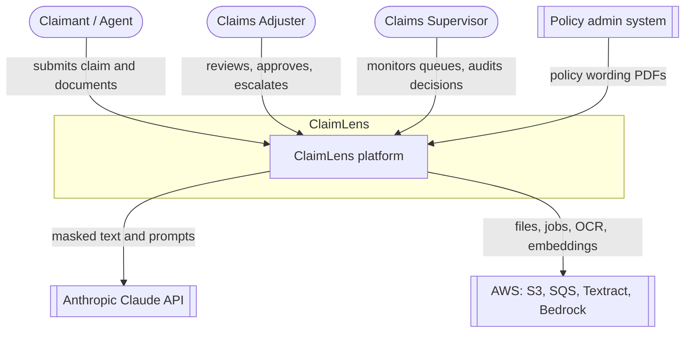
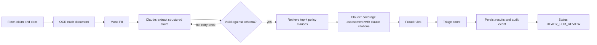
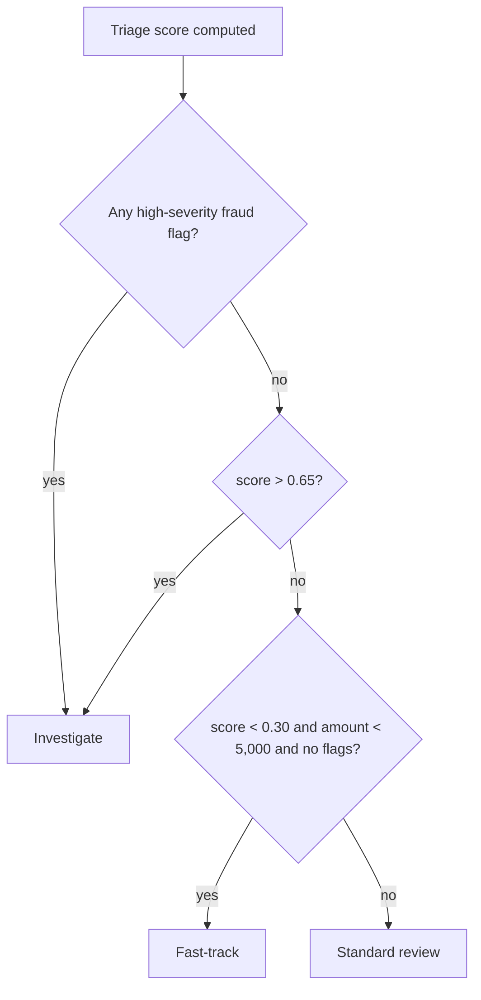

# ClaimLens architecture

## 1. Goals and constraints

| Goal | How the design addresses it |
| --- | --- |
| Adjusters stay in control | The system only *recommends* a queue and a summary. Every decision is a human action, and every action is audit-logged |
| No sensitive data sent to the LLM | PII is masked after OCR and before any model call; the token map is stored encrypted, never in prompts |
| Explainable output | Coverage reasoning must cite policy clause IDs retrieved by RAG; answers without valid citations are rejected by validation |
| Uploads never block | Upload returns immediately; processing runs asynchronously from a queue, with retries and a dead-letter queue |
| Runs on a laptop | Every AWS dependency has a local stand-in (LocalStack, Tesseract, local embeddings) behind an interface |

## 2. System context

## 3. Containers

| Container | Responsibility | Tech |
| --- | --- | --- |
| **Web** | Adjuster console: queues, claim detail, evidence viewer, actions | React, TypeScript, Vite |
| **API** | Auth, claim and document endpoints, presigned uploads, review actions | FastAPI |
| **Worker** | Consumes `claim.submitted` jobs and runs the pipeline | Python, boto3 |
| **PostgreSQL + pgvector** | Claims, extracted fields, policy chunks and embeddings, audit log | Postgres 16 |
| **Object storage** | Raw documents | S3 (LocalStack locally) |
| **Queue** | Decouples upload from processing; dead-letter queue after 3 failures | SQS (LocalStack locally) |

## 4. Worker pipeline

Each stage is a service class behind a small interface, so providers can be swapped (Textract or Tesseract, Bedrock or local embeddings) without touching the pipeline.

## 5. Triage scoring

`score = 0.45 × severity + 0.35 × fraud_risk + 0.20 × coverage_uncertainty` (each between 0 and 1)

Weights and thresholds live in configuration, not code.

## 6. Security

- **Authentication and authorization:** JWT access tokens; roles `ADJUSTER`, `SUPERVISOR`, `ADMIN`; adjusters only see claims assigned to their team
- **PII:** regex and checksum detectors (SSN, card numbers with Luhn check, IBAN, phone, email); tokens like `[SSN_1]` replace values in text sent to Claude
- **Prompt injection:** document text is passed as data inside clearly delimited blocks; responses are constrained to a JSON schema (structured outputs) and the model has no tools, so it cannot trigger actions
- **Audit:** append-only `audit_events` table records every status change, model call (prompt hash, model, tokens, latency) and human action

## 7. Diagrams

| Diagram | File |
| --- | --- |
| Use cases | [diagrams/use-cases.md](diagrams/use-cases.md) |
| Sequence: claim submission to triage | [diagrams/sequence-claim-processing.md](diagrams/sequence-claim-processing.md) |
| Sequence: adjuster review | [diagrams/sequence-adjuster-review.md](diagrams/sequence-adjuster-review.md) |
| Sequence: policy ingestion | [diagrams/sequence-policy-ingestion.md](diagrams/sequence-policy-ingestion.md) |
| Class diagram | [diagrams/class-diagram.md](diagrams/class-diagram.md) |
| Entity-relationship | [diagrams/er-diagram.md](diagrams/er-diagram.md) |
| Claim state machine | [diagrams/state-claim-lifecycle.md](diagrams/state-claim-lifecycle.md) |
| Deployment (local and AWS target) | [diagrams/deployment.md](diagrams/deployment.md) |

## 8. Decisions

- [ADR-0001: pgvector instead of a dedicated vector database](adr/0001-pgvector.md)
- [ADR-0002: Asynchronous queue-based pipeline](adr/0002-async-pipeline.md)
- [ADR-0003: Mask PII before any LLM call](adr/0003-pii-masking.md)
