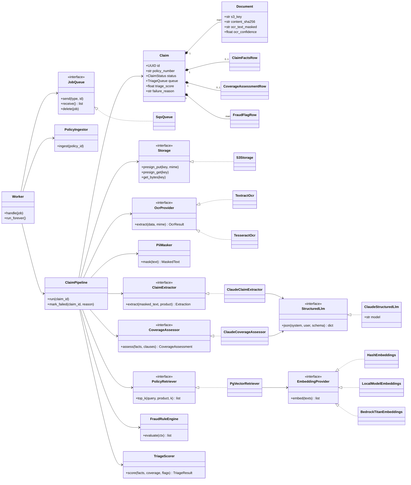

# Class diagram (domain and services)

Names match the code in `backend/app/`.

Every `<<interface>>` is a Python `Protocol`. `ClaudeStructuredLlm` calls `claude-opus-5-5` with JSON-schema structured outputs; `ClaudeCoverageAssessor` raises `CitationError` when a cited clause was not retrieved. The tests swap in fakes (`FakeStorage`, `FakeQueue`, `FakeLlm`) through the same interfaces.
