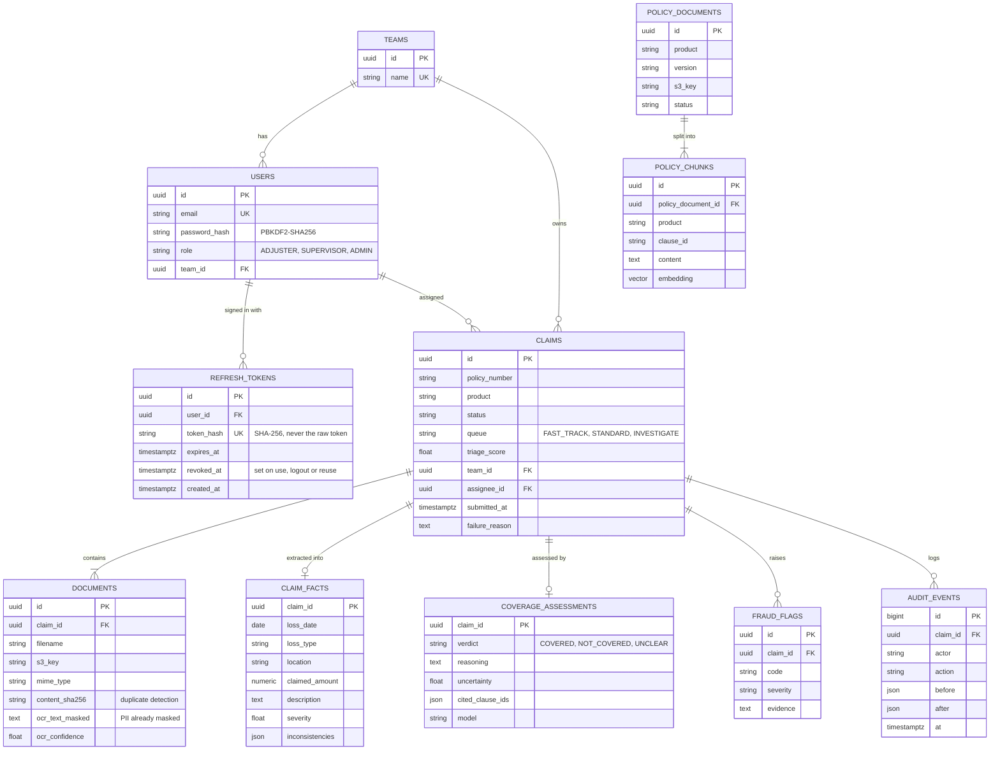

# Entity-relationship diagram

Mirrors `backend/app/db/models.py`.

`POLICY_CHUNKS.embedding` is `vector(1024)` with an HNSW index (`vector_cosine_ops`). `AUDIT_EVENTS` is append-only: the application never updates or deletes rows.
